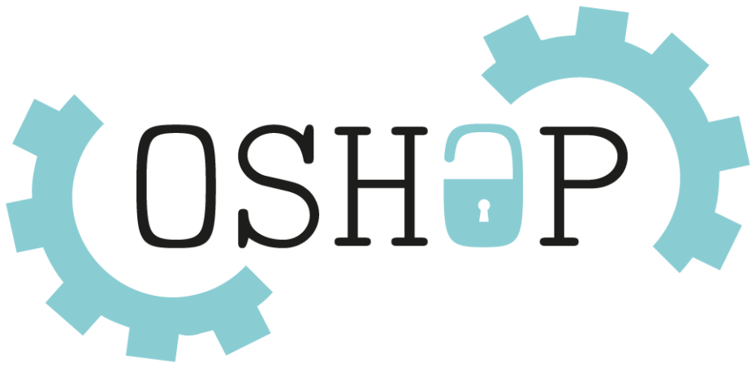
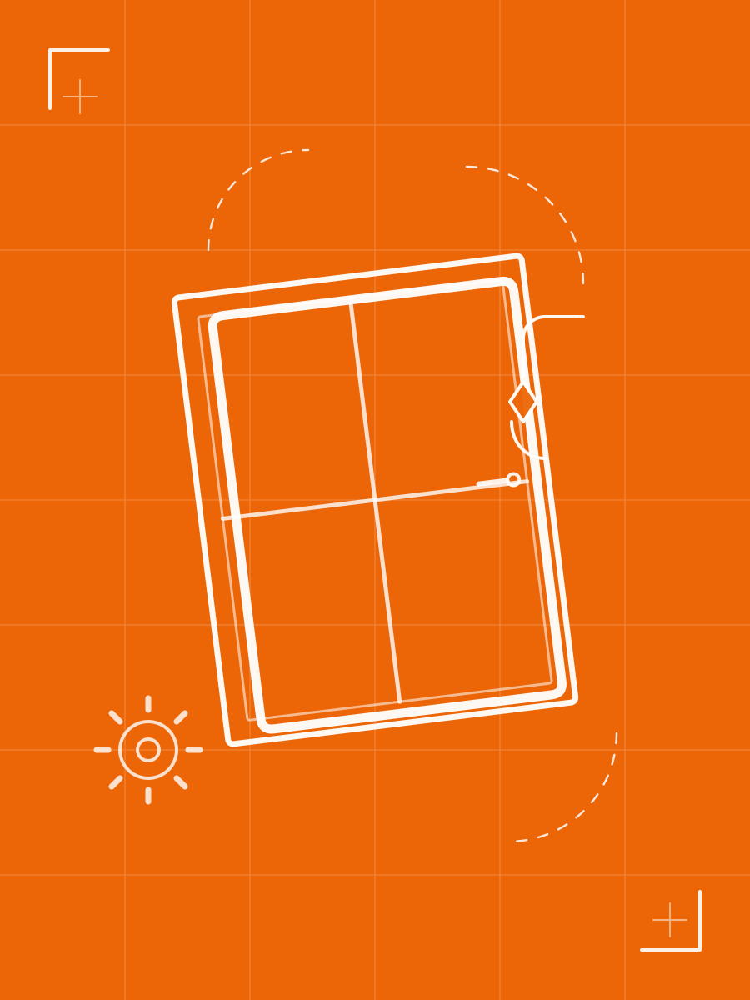
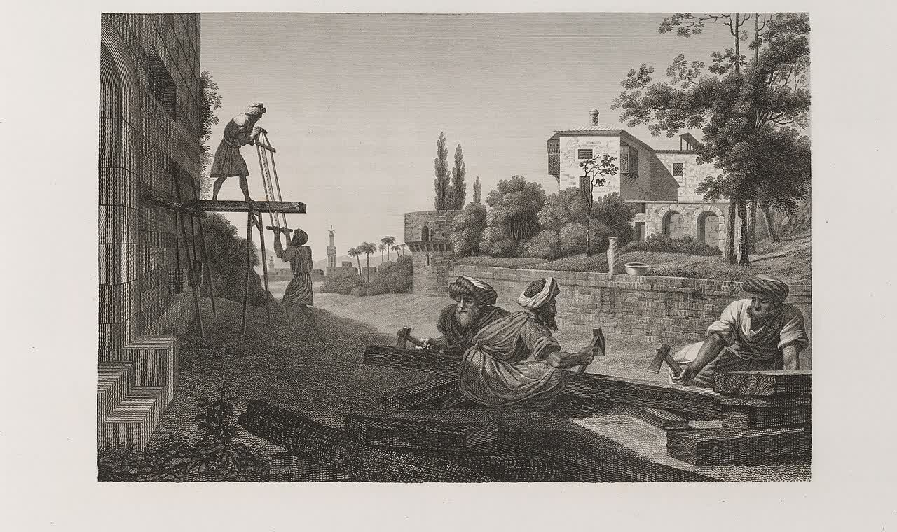
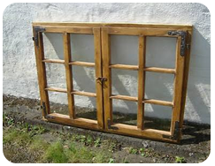
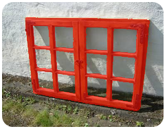
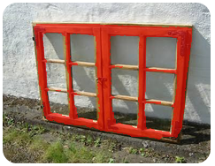

```{=html}
<div class="title-slide">
  <div class="ts-logo">
    
    
  </div>
  <div class="ts-photo">
    
  </div>
  <div class="ts-text">
    <div class="ts-kicker">Werkstattprojekt im T!Raum OSHOP</div>
    <h1>OHAWE</h1>
    <div class="ts-sub">Open Source Hardware im Handwerk —<br>Selbstsouveränität der deutschen Wirtschaft</div>
    <div class="ts-rule"></div>
  </div>
  <div class="ts-meta">
    <div class="meta-name">Stefan Helmert</div>
    <div class="meta-faculty">Fakultät Informatik / Mathematik, HTW Dresden</div>
    <div class="meta-date">OSHOP-Strategiemeeting · November 2026</div>
  </div>
</div>
```

::: {.notes}
Kurz ankommen: OHAWE ist ein Werkstattprojekt im Verbund T!Raum OSHOP, Laufzeit 03/2026–02/2029. Heute kein Technikvortrag, sondern ein Überblick: welches Problem, welche Idee, wo wir stehen, was das mit Infrastruktur und Transfer zu tun hat.
:::

---

## Hightech im Handwerk

::: {.eyebrow}
Worum es heute geht
:::

::: {.lead}
Nicht nur Hammer und Feile: Handwerksbetriebe setzen moderne Fertigung ein — und zwar längst.
:::

::: {.cases}
::: {.hwcase}
<span class="trade">Zahntechnik</span>
<p>Ein Dentallabor mit zwölf Mitarbeitenden fertigt 80 % digital und druckt rund 300 Modelle im Monat.</p>
<span class="src">Quelle: dental.formlabs.com, Anwenderbericht 2024</span>
:::
::: {.hwcase}
<span class="trade">Tischlerei</span>
<p>Tischlerei Müller (Duderstadt) rüstet 2025 auf 5-Achs-CNC und Fenster-CNC um — für Einzelteil-Komplettbearbeitung.</p>
<span class="src">Quelle: bm-online.de, Reportage 2025</span>
:::
::: {.hwcase}
<span class="trade">Metallbau</span>
<p>Ein Leipziger Handwerksbetrieb investiert 2022 in ein 5-Achs-Bearbeitungszentrum — für Einzel- und Kleinserien.</p>
<span class="src">Quelle: aischmann.de, Firmenchronik 2022</span>
:::
:::

<div style="height:0.5em"></div>

::: {.small}
<strong>Für kleinere Handwerksbetriebe oft unattraktiv:</strong>
:::

::: {.reasons}
<span>hohe Komplexität</span>
<span>hohe Investitionskosten</span>
<span>mangelnde Flexibilität</span>
<span>fehlendes Fachwissen</span>
<span>geringe Stückzahlen</span>
:::

::: {.chainline}
Problem › zwei Betriebe › offene Baupläne › Maschinen › Ihre Sicht
:::

::: {.notes}
Kein Inhaltsverzeichnis, sondern die Argumentkette — in 10 Minuten entlang dieser fünf Schritte, danach Diskussion (gut 20 min). Folienzuordnung: 3 Krise, 4 Erfinder, 5 Tradition, 6 Ziele, 7 Betriebe und Aufgaben — danach Diskussion.

Belege für die drei Beispiele, falls nachgefragt wird:
- Zahntechnik: Kreimer Dentallabor, Anwenderbericht Formlabs 2024 — über 80 % der Fälle digital, rund 300 gedruckte Modelle pro Monat, zwölf Zahntechniker:innen.
- Tischlerei: Tischlerei Müller, Duderstadt, bm-online.de 2025 — 5-Achs-BAZ Format4 Profit H350 plus 4-Achs-Fenster-CNC, CAD/CAM-Kette DDX, für Einzelteil-Komplettbearbeitung.
- Metallbau: Aischmann Präzisionstechnik, Leipzig, Firmenchronik — 5-Achs-BAZ 2017 und 2022 (DMG Mori), Betrieb 1981 als Handwerksbetrieb gegründet.

Backup-Zahlen für die Breite: 64 % der Tischlereien arbeiten mit CAD, 49 % mit CNC (Studie Digitalisierung im Tischlerhandwerk, 2019).

Pointe: Die Technik ist vorhanden, sie skaliert aber nicht auf Einzelstücke — dort bricht sie ab. Ehrlich bleiben: OHAWE steht in Monat 9 von 36.
:::

---

## Das Handwerk steckt in der Automatisierungskrise

::: {.eyebrow}
Ausgangslage
:::

::: {.stats}
::: {.stat}
<b>56 %</b>
<span>der Betriebe nennen Fachkräftemangel als größte Herausforderung</span>
:::
::: {.stat}
<b>−9,1 %</b>
<span>Tischlereibetriebe im Kammerbezirk Dresden seit 2020</span>
:::
::: {.stat}
<b>76 %</b>
<span>investieren weniger als 5.000 € pro Jahr in Hard- und Software</span>
:::
::: {.stat}
<b>15 %</b>
<span>sehen steigenden Automatisierungs- und Digitalisierungsdruck</span>
:::
:::

<div style="height:0.8em"></div>

::: {.quote}
Das Handwerk braucht unsere Unterstützung.
:::

::: {.notes}
Zahlen aus der Vorhabensbeschreibung, Quellen: Sächsischer Handwerkstag, HWK Dresden, Tischlerhandwerk NRW. Kern: kleine Betriebe, wenig Kapital, viel Arbeit. Das ist der Rahmen, in dem OHAWE arbeitet.
:::

---

## Die Not machte erfinderisch

::: {.eyebrow}
Erfunden in der Werkstatt, für die Werkstatt
:::

::: {.hist}
<div class="ev"><span class="yr">1886</span><span class="src"><strong>Rohrzange, 1892 der verstellbare Schraubenschlüssel</strong> — der Mechaniker Johan Petter Johansson baut beides in seiner Werkstatt, weil jede Mutter ein eigenes Werkzeug verlangte.<em>später Weltmarktartikel unter dem Namen Bahco</em></span></div>
<div class="ev"><span class="yr">1958</span><span class="src"><strong>Spreizdübel</strong> — der Schlosser Artur Fischer feilt ihn in seiner Werkstatt, weil Schrauben im Mauerwerk nicht halten.<em>Patent DE 1 097 117</em></span></div>
<div class="ev"><span class="yr">1958</span><span class="src"><strong>Kabelbinder</strong> — aus der Elektromontage, statt Binden mit Band und Draht.<em>heute in jedem Werkzeugkoffer</em></span></div>
:::

<div style="height:0.4em"></div>

::: {.quote}
Selbst bauen und selbst entwickeln war kein reiner Notbehelf — es war **Selbstverständnis**.
:::

::: {.notes}
Drei Beispiele, alle aus dem Betrieb heraus entwickelt: Johansson war Mechaniker in Enköping, Fischer gelernter Schlosser mit eigener Werkstatt im Schwarzwald. Das Muster ist immer dasselbe: ein konkretes Problem vor der Nase, keine Lösung auf dem Markt, also selbst bauen. Der Unterschied zu heute: damals wurde daraus ein Produkt hinter Patent und Werkstattmauer — OSH dreht das zurück. Kabelbinder: 1958 von Thomas & Betts für die Elektromontage entwickelt.
:::

---

## Werkzeuge bauen, Vorlagen nachbauen

::: {.eyebrow}
Das ist keine neue Idee — nur eine vergessene
:::

::: {.two .hist-split}
::: {.pane}
::: {.hist}
<div class="ev"><span class="yr">~1240</span><span class="src"><strong>Bauhüttenbuch</strong> des Villard de Honnecourt — Risse und Konstruktionen, zwischen Bauhütten weitergegeben.<em>Skizzenbuch, kein Bauplan</em></span></div>
<div class="ev"><span class="yr">1588</span><span class="src"><strong>Ramelli</strong> veröffentlicht 195 Maschinenentwürfe — zum Nachbau, für Bauherren und Handwerker.<em>Kupferstiche ohne Maße</em></span></div>
<div class="ev"><span class="yr">1731</span><span class="src"><strong>Schübler</strong> schreibt Zimmermannskunst „denen Zimmer-Leuten zum besten" — mit Tafeln für Dächer und Hängewerke.<em>Lehrbuch mit Zielgruppe Handwerk</em></span></div>
:::

<div style="height:0.5em"></div>

::: {.quote}
Open Source Hardware hat eine lange Tradition. Was fehlte: **Maße, Rückfluss, Lizenz.**
:::
:::
::: {.pane}


::: {.tiny}
Handwerker bei der Arbeit mit eigenem Werkzeug. Tafel aus „Arts et Métiers", 19. Jahrhundert (NYPL, gemeinfrei).
:::
:::
:::

::: {.notes}
Eigene Werkzeuge, Schablonen und Vorrichtungen waren Werkstattalltag: Für Einzelstücke gab es nichts von der Stange, und Geld war knapp. Veröffentlicht wurde trotzdem — Muster- und Modelbücher, Bauhüttenrisse, Maschinenbücher, Zimmermannsbücher. Genau das ist die Wurzel, auf die OSH sich beruft. Der Unterschied liegt nicht in der Haltung, sondern in drei fehlenden Dingen: nachbaubare Daten, ein Weg für Verbesserungen zurück, Rechtssicherheit. Nicht behaupten, Wissen sei nur mündlich gewesen.
:::

---

## Ziele

::: {.eyebrow}
Was OHAWE erreichen will
:::

::: {.lead}
Ziel ist **OSH-Transferkompetenz im Handwerk**: Betriebe sollen selbst finden, prüfen, nachbauen, anpassen und veröffentlichen können.
:::

::: {.goals}
- Lock-In-Effekte erkennen und vermeiden
- Anwendung von OSH-Entwurfsmustern und -Paradigmen, um Barrieren zu senken
- eigenständige Recherche geeigneter OSH-Teillösungen
- Nachbau und Anpassung an die eigene Werkstatt
- Veröffentlichung der eigenen Lösungen unter offener Lizenz
- Kooperation mit anderen Handwerksbetrieben, Hochschulen und OSH-Community
:::

<div style="height:0.5em"></div>

::: {.quote}
Nicht drei Jahre Sondermaschine — sondern ein **nachbaubarer Baukasten** und die Fähigkeit, ihn zu nutzen.
:::

::: {.notes}
Ziele aus der Vorhabensbeschreibung, für dieses Publikum übersetzt: Es geht nicht um zwei Maschinen als Selbstzweck, sondern um den Nachweis, dass OSH im Handwerk funktioniert — technisch und organisatorisch. Der Rückfluss in den Verbund ist ausdrücklich Teil des Arbeitsplans (AP 6.2).
:::

---

## Zwei Betriebe, Synergieeffekte nutzen

::: {.eyebrow}
Und was wir dafür bauen
:::

::: {.two}
::: {.pane}
<h3>Fensterbau König</h3>
::: {.small}
- Silikonfuge an Holzfenstern wird von Hand gezogen
- monoton, fehleranfällig, jede Form braucht eine neue Handbewegung
- Marktlösungen sind zu unflexibel und zu teuer
:::

::: {.answer}
**Unsere Antwort:** ein Werkzeug, das Dichtstoff dosiert aufträgt und abzieht — auf Basis der vorhandenen Maschine.
:::
:::
::: {.pane}
<h3>Restauration Pohl</h3>
::: {.small}
- alte Lackschichten werden von Hand abgetragen
- das Grundmaterial darf dabei nicht verletzt werden
- Staub und Dämpfe belasten, Erfahrungswissen geht in Rente
:::

::: {.answer}
**Unsere Antwort:** eine Fräse, die das Werkstück vermisst und mit wechselnden Werkzeugen arbeitet.
:::
:::
:::

<div style="height:0.4em"></div>

::: {.tiny}
Beide Betriebe sind Projektpartner, nicht Anwender. Gebaut und erprobt wird im Versuchsfeld der HTW Dresden, danach gehen die Maschinen in die Betriebe.
:::

::: {.notes}
Überblick, keine Konstruktionsdetails. Punkt: wir entwickeln keine Maschine von der Stange, sondern zwei sehr unterschiedliche Anwendungen — Retrofit und Neubau. Genau daran lernen wir, was übertragbar ist.
:::

---

## Zwischenstand — Fokus auf Software

::: {.eyebrow}
KI findet den Fensterrahmen
:::

::: {.lead}
Vor dem ersten Weg muss die Maschine wissen, wo der Rahmen anfängt: Wir erproben offene Segmentierungsmodelle an eigenen Aufnahmen.
:::

::: {.shots}
<figure><span class="cap">Ausgangsaufnahme</span></figure>
<figure><span class="cap">Grounding DINO + SAM 2</span></figure>
<figure><span class="cap">SegGPT</span></figure>
:::

<div style="height:0.4em"></div>

::: {.quote}
Noch Laborstand — aber der Schritt, an dem aus einer Werkzeugidee eine Maschine wird.
:::

::: {.notes}
Zwischenstand aus der Software: Wir testen offene Modelle (Grounding DINO + SAM 2, SegGPT) darauf, den Fensterrahmen in der Aufnahme zu finden. Das ist die Voraussetzung für Bahnplanung und Dosierung. Ehrlich sagen: keine belastbaren Kennzahlen, das ist ein früher Versuch.
:::

---

## Danke — Diskussion

::: {.two}
::: {.pane}
::: {.contact}
**Stefan Helmert**\
Professur Informationsmanagement\
Fakultät Informatik / Mathematik\
HTW Dresden\
\
stefan.helmert@htw-dresden.de
:::
:::
::: {.pane}
::: {.small}
**Projekt OHAWE**\
Open Source Hardware im Handwerk\
T!Raum OSHOP · Laufzeit 03/2026–02/2029\
\
Verbund: HTW Dresden, Tischlerei Pohl\
Assoziiert: Tischlerei König, Handwerkskammer Dresden
:::
:::
:::

<div style="height:0.7em"></div>

::: {.partner-logos}


:::

::: {.tiny}
Ein Werkstattprojekt im T!Raum OSHOP. Gefördert im Rahmen der Fördermaßnahme „T!Raum — TransferRäume für die Zukunft von Regionen" des BMBF im Programm „Innovation & Strukturwandel". Ergebnisse werden unter offener Lizenz veröffentlicht.
:::

::: {.notes}
Kontakt stehen lassen, während die Diskussion läuft.
:::

---

## Backup: Partner und Rollen

::: {.eyebrow}
Auf einen Blick
:::

| Partner | Rolle im Projekt |
|---|---|
| **HTW Dresden**, Professur Informationsmanagement | Koordination, FuE, Aufbau und Erprobung der Demonstratoren, Dokumentation, Zertifizierung |
| **Tischlerei Pohl**, Ebersbach-Neugersdorf | Anforderungen an Lackentfernung, Versuchsergebnisse/Parameter Laser-Lackentfernung, Gefährdungsbeurteilung |
| **Tischlerei König**, Rammenau | Fensterbau, stellt die vorhandene Maschine, Anforderungsmanagement, Erprobung (assoziiert) |
| **Handwerkskammer Dresden** | Multiplikator in ~21.000 Betriebe, gemeinsame Veranstaltungen mit OSHOP |

::: {.notes}
Nur auf Nachfrage zeigen.
:::
